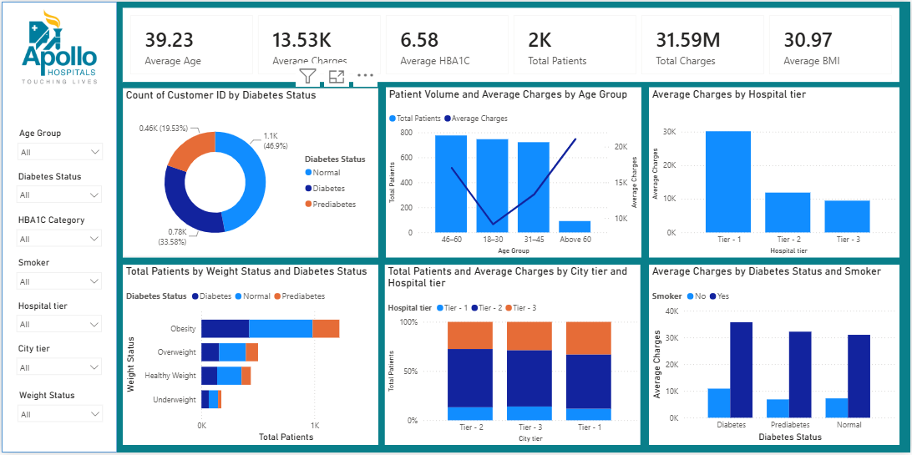

# Apollo Hospitals – Diabetes Patient Analytics Dashboard

An interactive **Power BI dashboard** for exploring patient demographics, diabetes status, hospital charges, and related health indicators using an Apollo Hospitals patient dataset.

> **Project files:** This repository is intended to contain the dataset, the Power BI report (`.pbix`), the dashboard preview image, and this README.

## Dashboard Preview

Add the dashboard screenshot to the repository and name it `dashboard.png` (or update the path below to match your filename).



## Project Overview

The dashboard brings key patient and billing indicators into one interactive view. It helps users explore how patient volume and average hospital charges vary across age groups, hospital tiers, city tiers, diabetes categories, smoking status, and weight status.

The report includes slicers for:
- Age Group
- Diabetes Status
- HBA1C Category
- Smoker
- Hospital Tier
- City Tier
- Weight Status

Selecting a slicer value filters the dashboard visuals to support focused analysis.

## Key Performance Indicators

The screenshot shows the following headline metrics:

| KPI | Value shown |
|---|---:|
| Average Age | 39.23 |
| Average Charges | 13.53K |
| Average HBA1C | 6.58 |
| Total Patients | 2K |
| Total Charges | 31.59M |
| Average BMI | 30.97 |

*Values are reproduced from the dashboard screenshot and may change when filters are applied or when the underlying dataset is updated.*

## Dashboard Visuals

1. **Patient count by diabetes status** – Donut chart comparing Normal, Diabetes, and Prediabetes categories.
2. **Patient volume and average charges by age group** – Combines patient counts and average charges across age groups.
3. **Average charges by hospital tier** – Compares average charges across Tier 1, Tier 2, and Tier 3 hospitals.
4. **Patients by weight status and diabetes status** – Stacked horizontal bar chart showing the distribution across Underweight, Healthy Weight, Overweight, and Obesity.
5. **Patients and hospital tier by city tier** – Stacked column chart comparing hospital-tier composition across city tiers.
6. **Average charges by diabetes status and smoker** – Compares average charges for smokers and non-smokers across diabetes categories.

## Tools and Technologies

- **Microsoft Power BI Desktop** – Data modelling, report development, interactive slicers, and visualisation.
- **Dataset** – Patient-level data supplied with this repository.
- **GitHub** – Project versioning and sharing.

## Repository Structure

Upload your files using a structure similar to this:

```text
apollo-hospitals-diabetes-dashboard/
│
├── README.md
├── dashboard.png
├── dataset/
│   └── your_dataset_file.xlsx
└── report/
    └── your_power_bi_report.pbix
```

You can keep the dataset and PBIX file in the repository root instead. If you do, update the structure above to reflect the actual filenames and folders.

## How to View the Dashboard

1. Download or clone this repository.
2. Open the `.pbix` file using **Power BI Desktop**.
3. If Power BI asks for the dataset location, select the dataset included in this repository.
4. If required, update the data source path in Power BI and refresh the report.
5. Use the slicers to filter the report and explore the visuals.

## Notes

- The KPI values shown above are the values visible in the supplied dashboard screenshot; they are not guaranteed to remain the same after filtering or refreshing.
- Check that the dataset path and column names match the data source used by the PBIX file before publishing.
- Remove or anonymise personally identifiable or confidential patient information before uploading any dataset publicly. Only share data that you are authorised to publish.
- This dashboard is intended for learning and analytical demonstration. It should not be used to make medical diagnoses or treatment decisions.

## Author

**Harshit Kumar Pandey**\
MBA -- Business Analytics\
Interested in Data Analytics, Business Intelligence, and data-driven
decision-making.

------------------------------------------------------------------------

If you find this project useful, feel free to ⭐ the repository.
